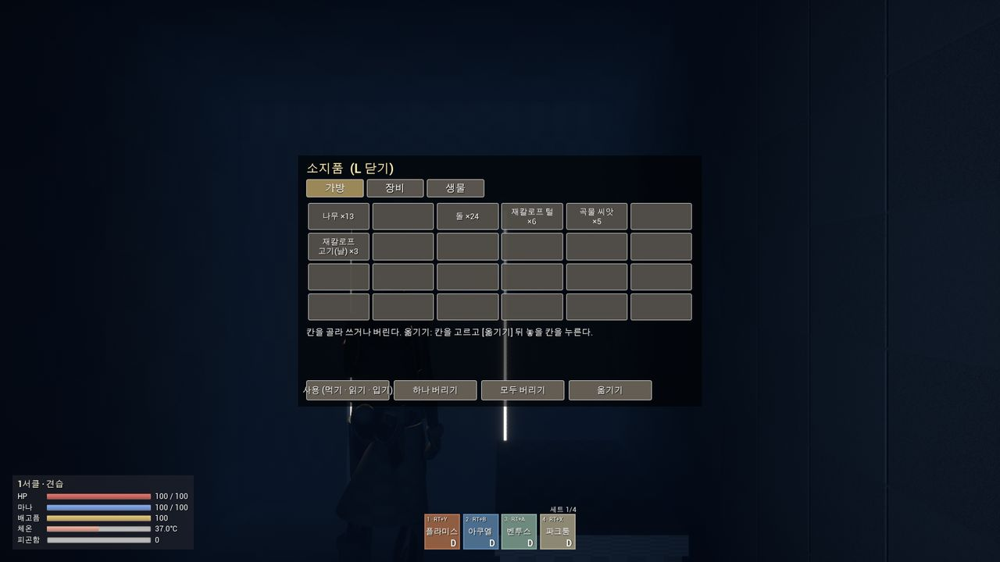
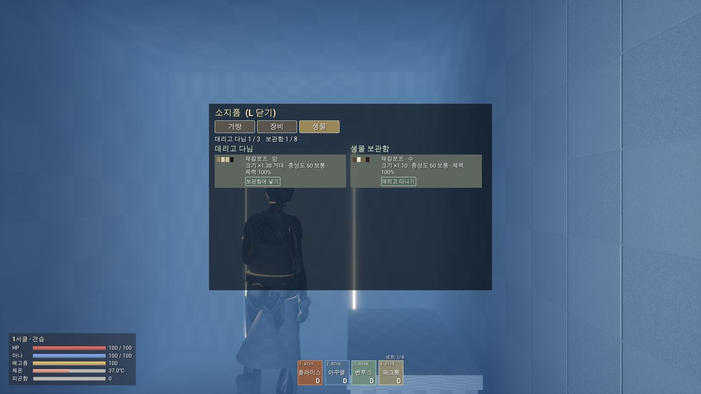
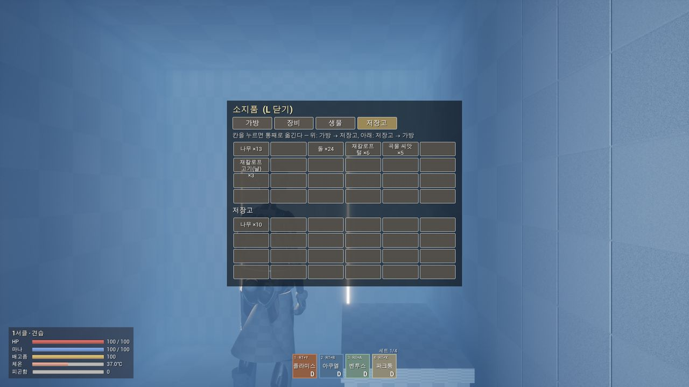
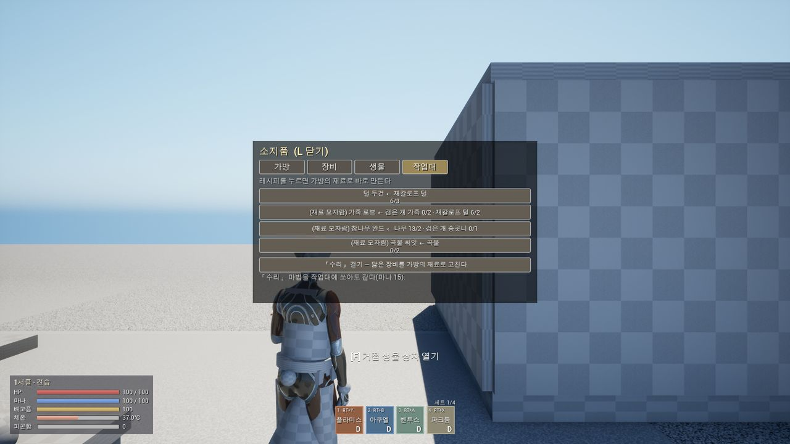
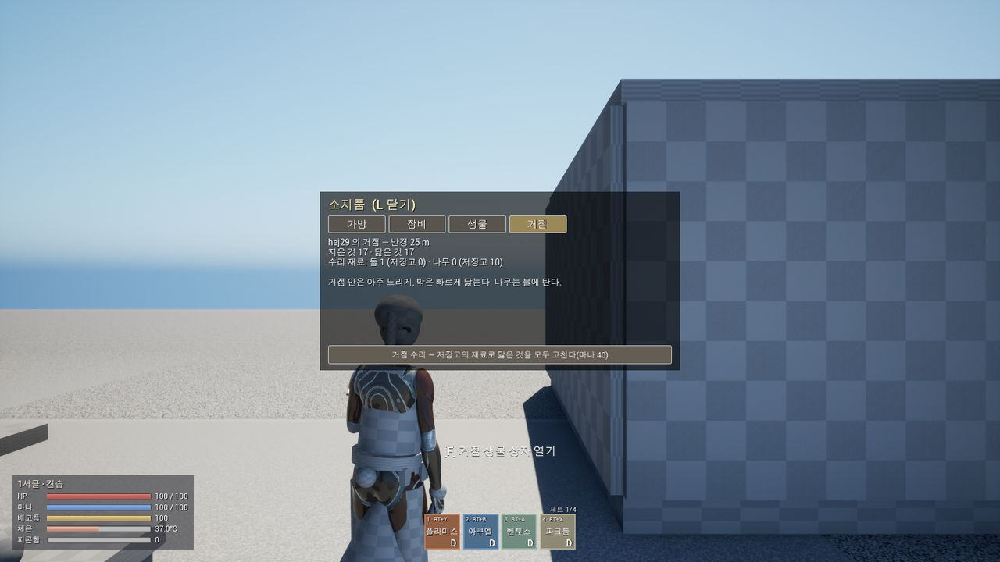
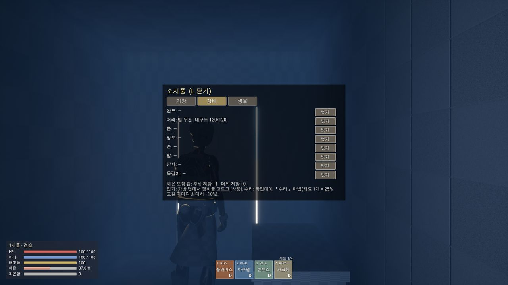
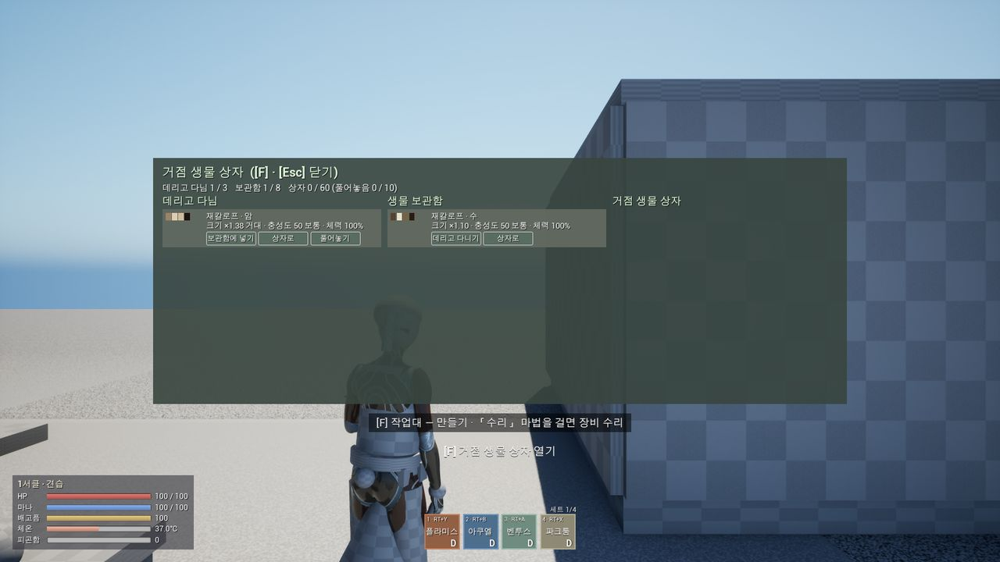
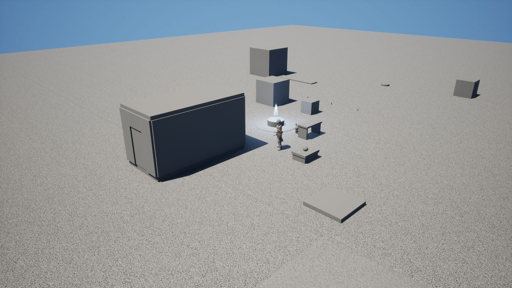
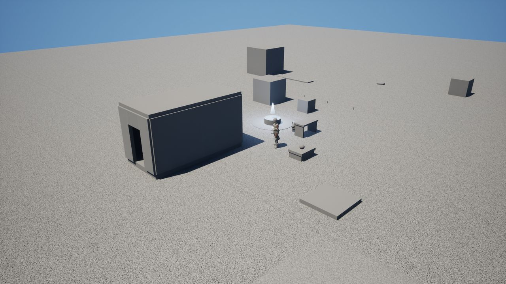

# QA — M4 거점 + R38 생물 보관 통합

> 대상: 브랜치 `claude/relaxed-payne-b149cb`(M4 `6abd568` 을 main 위에 합친 것). 확인한 날 2026-11-06, 확인한 사람 Claude(통합 세션).
> 무엇을 만들었나: [M4 작업 계획](../systems/m4-plan) 「R38 생물 보관과 합친 뒤」, [생물 시스템 — 거점 생물 상자](../systems/creatures#거점-생물-상자-agrimcreaturebox), 스펙 [하우징 · 거점](../spec/housing#지금-만든-것-m4-·-2026-11-06) · [마법 생물](../spec/creatures#거점-생물-상자-팰월드-팰-상자-참고).

결과 기호: ✅ 기대대로 · ❌ 기대와 다름(고칠 것). 「근거」의 로그 · 그림은 다시 돌리면 같은 자리에 다시 생긴다(아래 「다시 돌리기」).

## A. 합치기가 깨뜨린 것이 없나

| # | 항목 | 방법 | 기대 | 결과 | 근거 |
|---|---|---|---|---|---|
| A1 | 빌드 | `Build.bat GrimoireEditor Win64 Development` | `Result: Succeeded` | ✅ | 빌드 로그 |
| A2 | 자동화 테스트 전부 | `UnrealEditor-Cmd … -ExecCmds="Automation RunTests Grimoire; Quit" -NullRHI` | 모두 통과, 154(M4) + 생물 보관 테스트 이상 | ✅ | `Found 168 automation tests` · `Result={Success}` 168 · `{Fail}` 0 |
| A3 | 아이템 · 조각 표 | `Grimoire.Items.Table` · `Grimoire.Base.Table`(A2 안) + CSV 첫 열 중복 검사 | 표 문제 0, ID 중복 0 | ✅ | Items.csv 35행 · BuildPieces.csv 19행 중복 0 |
| A4 | 두 갈래의 ini 절 | `Config/DefaultGame.ini` 에서 절 · 줄 세기 | `GrimCreatureStorageSettings` · `GrimShopSettings` · `GrimBaseSettings` 각 1, `+InventoryTabClasses=` 5줄 | ✅ | 1 · 1 · 1, 5줄 |
| A5 | 미결 질문 번호 | decisions.md 의 `\| Qn \|` 줄 순서 · 중복 | 오름차순(Q60~Q64 → Q65~Q74 → Q75~), 중복 0 | ✅ | 89줄, Q1~Q96 오름차순, 중복 0 |
| A6 | 문서 사이트 | `npm run docs:build` | 깨진 링크 없이 빌드 | ✅ | `build complete` |

## B. 소지품 「생물」 탭 (M4 탭 틀로 옮김)

| # | 항목 | 방법 | 기대 | 결과 | 근거 |
|---|---|---|---|---|---|
| B1 | ini 한 줄로 등록 · 순서 | 테스트 `Grimoire.Base.CreatureBox.Data` | `InventoryTabClasses` 에 `GrimCreatureStorageTab`, 탭 ID `Creatures`, 순서 10 < 15 < 20 | ✅ | A2 |
| B2 | 시설을 안 열었을 때 탭 줄 | 창 모드 실행 `Grim.Base.Bag Bag` → `shot showui` | 가방 · 장비 · 생물 셋만 | ✅ |  |
| B3 | 생물 탭 목록 | 재칼로프 둘 길들임 · 하나 보관함 → `Grim.Base.Bag Creatures` | 「데리고 다님 1/3 · 보관함 1/8」, 줄마다 색 칸 · 종 · 성별 · 크기 · 충성도 · 체력 + 「보관함에 넣기」/「데리고 다니기」 | ✅ |  |
| B4 | 시설 탭이 생겨도 생물 탭 자리 그대로 | 저장고 · 작업대 · 거점 핵 곁에서 `Grim.Base.Bag Storage/Workbench/Base` | 가방 · 장비 · 생물 · (그 시설 탭) — 생물이 셋째 그대로 | ✅ |    |
| B5 | 장비 탭(M4)이 그대로 | `Grim.Base.Bag Equipment` | 8칸 · 털 두건 내구도 120/120 · 추위 저항 +1 | ✅ |  |

## C. 건축 시설 「생물 상자」

| # | 항목 | 방법 | 기대 | 결과 | 근거 |
|---|---|---|---|---|---|
| C1 | 조각 표 · 클래스 | 테스트 `Grimoire.Base.CreatureBox.Data` | `CreatureBox` = Station, 스폰 클래스가 `AGrimBaseCreatureBox`, 구조 컴포넌트 있음 | ✅ | A2 |
| C2 | 건축으로 놓기 | `Grim.Base.PlaceAt CreatureBox 1 -2 0 100 0` → `Grim.Base.Dump` | `놓음 CreatureBox → GrimBaseCreatureBox_0`, `hp=200.0/200.0 inBase=1` | ✅ | `Saved/BaseCapture/capture.log` |
| C3 | 지은 상자의 관리 화면 | 곁에서 `Grim.Taming.Box Open` → `shot showui` | 세 칸(데리고 다님 · 보관함 · 상자), 「상자 0/60 (풀어놓음 0/10)」, 줄마다 단추 | ✅ |  |
| C4 | 부서지면 → 다른 상자로 | 테스트 `Grimoire.Base.CreatureBox.Rescue`(지은 상자 2칸 → 철거 → 다른 상자) | 다른 상자에 2칸, 이름 · 씨앗 그대로, 상자 안 상태 | ✅ | A2 |
| C5 | 지은 상자에 넣고 풀어놓기 | `Scripts/Base/qa_creature_box.ps1` 1회차 | `party=0/3 box=yes boxEntries=1 released=1` | ✅ | `Saved/QA/creature_box_1.log` |
| C6 | 쿠스토디아 없이 철거(Q42 뒤) | 같은 스크립트 2회차: 쿠스토디아 안 배움(디버그) · 다른 상자 없음 → 철거 | 안 배워도 기본 보관함 10칸으로 — `stored=1/10 box=no`, 경고 0줄(예전 기대 「사라짐」은 Q42 로 바뀜. 보관함까지 가득해 사라지는 경우는 이 스크립트로 만들지 않는다) | ✅ 11-07 | `Saved/QA/creature_box_2.log` |
| C7 | 철거 환급 | 놓은 뒤 · 철거 뒤 `Grim.Items.Dump` | 비용(나무 10 · 돌 4)의 절반 = 나무 +5 · 돌 +2 | ✅ | 나무 15 · 돌 11 → 나무 20 · 돌 13 |
| C8 | 저장 → 다시 켜기 | 1회차 `Grim.Save.Now` → 같은 슬롯(`?SaveSlot=QABox`)으로 2회차 | 지은 상자 `hp=200/200`, 칸 1 · 풀어놓음 1, 풀어놓은 재칼로프가 세계에 다시 나옴 | ✅ | `GrimBaseCreatureBox_0 … hp=200.0/200.0`, `storagerow place=Released`¹ |
| C9 | 철거하면 → 주인 보관함으로 | 2회차: 다른 상자 없음 · 보관함 배움 → 풀어놓은 생물이 든 상자 철거 | `stored=1/18 box=no released=0`(Q42 뒤 — 배웠으면 10 + 8), 풀어놓은 액터는 거둠 | ✅ | `Saved/QA/creature_box_2.log` |

¹ `Grim.Taming.Dump` 는 명령을 Wait/Follow 둘로만 찍어 풀어놓은 생물(Roam)도 `cmd=Follow` 로 보인다 — 자리는 `Grim.Taming.StorageDump` 의 `place=Released` 로 본다.

## D. 회귀 (두 갈래 각자의 2인 확인)

| # | 항목 | 방법 | 기대 | 결과 | 근거 |
|---|---|---|---|---|---|
| D1 | 생물 보관 2인 | `Scripts/Creatures/net_check_storage.ps1 -Port 17893` | `NETCHECK_RESULT fail=0`, 덤프 5개 서버 · 클라이언트 같음 | ✅ | `Saved/NetCheckStorage/*.log` |
| D2 | 거점 2인 | `Scripts/Base/net_check_base.ps1 -Port 17895` | M4 기록과 같은 값: 양쪽 조각 10 · 지은 것 17, 밤 0.921 → 0.194(day 1), 저장고 남은 나무 2, 털 두건 101/108, 벽 150/150, 곡물 3, 문 철거 뒤 9 · 16 | ✅ | `Saved/NetCheck/base_*.log` |
| D3 | 지은 집 모습 | 창 모드 `HighResShot`(고정 카메라) · 문 열기 | 바닥 2 · 벽 · 지붕 · 문(열면 문간), 거점 핵 · 작업대 · 생물 상자 · 밭이 보임 | ✅ |   |

## E. 화면에서 찾은 문제 (합치기 전부터 있던 것 — 고칠 것)

| # | 항목 | 방법 | 기대 | 결과 | 근거 |
|---|---|---|---|---|---|
| E1 | 가방 행동 단추 글 | B2 그림 | 「사용 (먹기 · 읽기 · 입기)」가 단추(160 px) 안에 | ❌ 단추 밖으로 넘친다 | 00_bag |
| E2 | 작업대 레시피 줄 | B4 그림 | 한 줄 레시피가 칸 안에 | ❌ 두 줄로 접혀 아랫줄(「6/3」 · 「0/2」)이 잘린다 | 04_workbench |
| E3 | 저장고 칸 이름 | B4 그림 | 칸 안에 이름 · 수 | ❌ 「재칼로프 고기(날) ×3」이 칸 높이를 넘친다 | 03_storage |
| E4 | 집 안 벽 이음새 | B2 · B5 그림(집 안) | 벽 사이가 막힘 | ❌ 두 칸 벽이 만나는 곳에 세로 빛줄기가 샌다 | 00_bag · 01_equipment |
| E5 | 생물 상자 높이 | D3 그림 | 상자가 땅 위에 | ❌ 반쯤 땅에 묻혀 보인다(기본 도형 상자 몸의 원점이 가운데) | 07_house |

- 참고: 집 안 그림이 어두운 것은 모닥불을 켜지 않았고 지붕이 해를 막아서다(정상).

## F. 수리 해금 (Q121 답 2026-11-07)

| # | 항목 | 방법 | 기대 | 결과 | 근거 |
|---|---|---|---|---|---|
| F1 | 레스티투오 전엔 작업대 「수리」 잠김 · 까닭 알림(Q64 방식, 연출 없음) → 2서클에 배우면 재료로 고침 · 최대치 −10%, 막시마 전엔 거점 「전체 수리」 잠김 → 스킬북(4서클)으로 배움 · 2서클엔 못 읽음, 세이브 `Base.Skills` 왕복 | ① `Grimoire.Base.Repair.Unlock` | 통과 | ✅ 11-07 | 자동화 173/173 |
| F2 | 마법탑 대리 수리(솔): 멀쩡하면 `Repair.Nothing`, 솔 모자람 `Repair.NoMoney`(그대로), 값 = 재료 몫 × 5 솔, 고치면 수리 횟수 1 · 새 최대치까지, 재료는 안 받음. 대사 표가 두 맥락을 요구 | ① `Grimoire.Base.Repair.NpcService` · `Grimoire.Quest.Table` | 통과 | ✅ 11-07 | 자동화 173/173 |
| F3 | 2인: 레스티투오 · 막시마 없이 누르면 **서버가 판정**하고 그 사람의 소유 클라이언트에만 까닭 한 줄 — 피식 연출은 없음 | ④ `Scripts/Base/net_check_repair.ps1` | 서버 `수리 잠김: 레스티투오 필요` ×2 · `… 막시마 필요` ×2(클라이언트 · 호스트), `[Client] 마법 실패 알림 RepairLocked` · `BaseRepairLocked`, 호스트 몫은 서버 로그 | ✅ 11-07 | `Saved/repair_result.txt` — 클라이언트 알림 RepairLocked 2 · BaseRepairLocked 1, 호스트 알림 1, 연출 0, `NETCHECK_RESULT fail=0` |
| F4 | 2인: 레스티투오를 배운 뒤 작업대 「수리」(장비) · 조각 하나(저장고 몸) | ④ 같은 스크립트 | `장비 수리 Wand_Basic: 재료 Wood ×2 → 180/180(수리 1번)` · `수리 GrimStorageChest_0: Wood ×2 → 150/150` | ✅ 11-07 | 같음 |
| F5 | 2인: 막시마를 배운 뒤 거점 핵 「전체 수리」(저장고 재료) | ④ 같은 스크립트 | `노말 스킬 RestituoMaxima 배움` · `거점 수리: 닳은 것 n, 저장고 재료 m` | ✅ 11-07 | `거점 수리: 닳은 것 3, 저장고 재료 2` |
| F6 | 회귀: 거점 2인(레스티투오를 배워 작업대 · 벽 수리) | ④ `Scripts/Base/net_check_base.ps1` | 털 두건 수리 · 벽 150/150 등 M4 기록과 같음 | ✅ 11-07 — 1 · 2회차는 이 워크트리에 앞선 점검이 남긴 세이브(`Saved/SaveGames`)로 호스트가 다른 자리에서 시작해 거점 핵이 샌드박스 소품과 겹쳐(`놓기 거절 BaseCore: 무언가와 겹친다 StaticMeshActor_1`) 아무것도 못 지음 — 세이브를 치우고 3회차 통과(수리와 무관, 스크립트가 세이브를 지우지 않는 문제) | `Saved/NetCheck/base_server.log` — `cores=1 pieces=10 structures=17`, 밤 0.921 → 0.194(day 1), `장비 수리 FurHood: 재료 JackalopeFur ×3 → 101/108(수리 1번)`, `수리 GrimBuildPiece_2: Wood ×3 → 150/150`, 철거 뒤 9 · 16 |
| F7 | 화면: 작업대 옆 「수리」 탭(잠김 한 줄 · 장비 목록 · 단추), 거점 탭 「전체 수리 (잠김)」 글 | ③ 사람 눈 | 잠김 · 열림 글이 바뀐다 | ⏸ 11-07 — `Grim.Base.Bag` 가 「수리」 탭을 아직 열지 못해 장면을 못 만듦(탭 글은 ① 의 같은 함수 `UGrimRepairTab::DescribeLock`) | — |
| F8 | 2인: 마렌과 대화해 「대리 수리 (솔)」 메뉴를 고름 | ④ | `대리 수리: … 재료 몫 n → m Solidus` | ⏸ 11-07 — 헤드리스에서 NPC 메뉴를 고르는 명령이 없다(서비스 함수는 F2 에서 확인) | — |

## 다시 돌리기

```powershell
# 빌드 · 자동화 테스트는 CLAUDE.md 「자주 쓰는 명령」
powershell -File Scripts\Base\qa_creature_box.ps1           # C5~C9 — 끝줄 QA_RESULT fail=0
powershell -File Scripts\Base\capture_base.ps1              # B2~B5 · C3 · D3 그림 → Saved\BaseCapture
powershell -File Scripts\Creatures\net_check_storage.ps1    # D1
powershell -File Scripts\Base\net_check_base.ps1            # D2 · F6
powershell -File Scripts\Base\net_check_repair.ps1          # F3~F5
```

- 새 워크트리는 LFS 에셋이 포인터 그대로일 수 있다 — `git lfs checkout` 을 먼저 하지 않으면 A2 가 실패하거나 엔진이 죽는다.
- 다른 세션이 같은 포트로 2인 확인을 돌릴 수 있으니 `-Port` 를 따로 준다.
